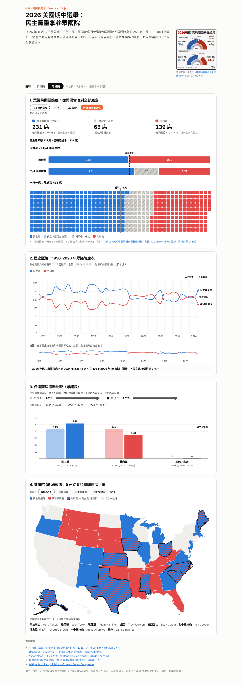
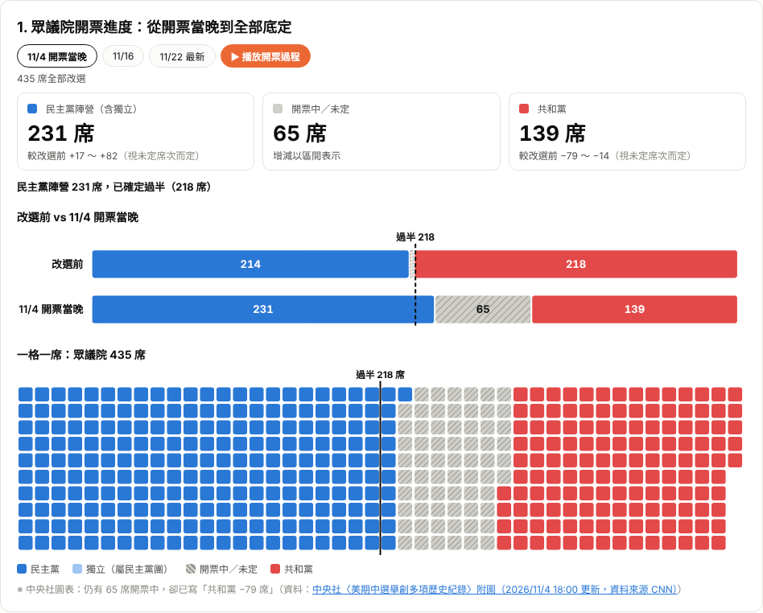
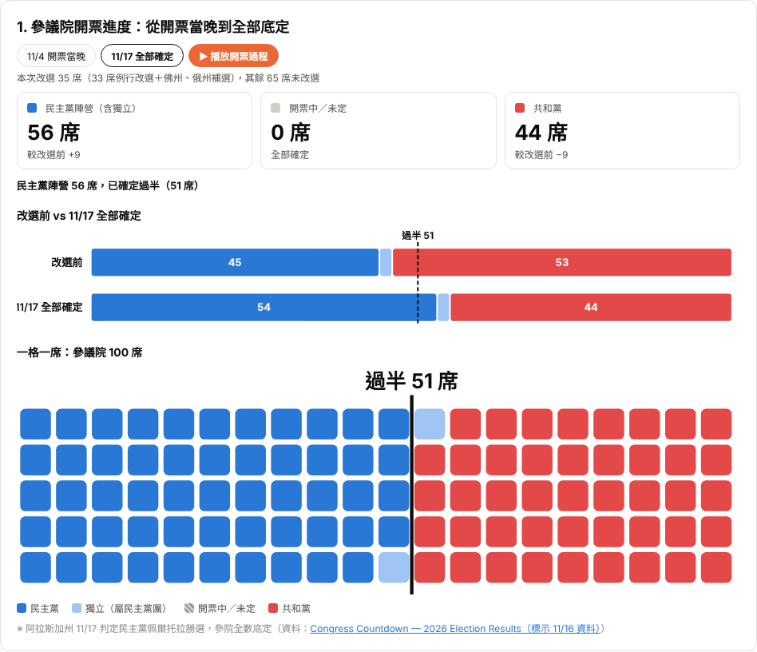
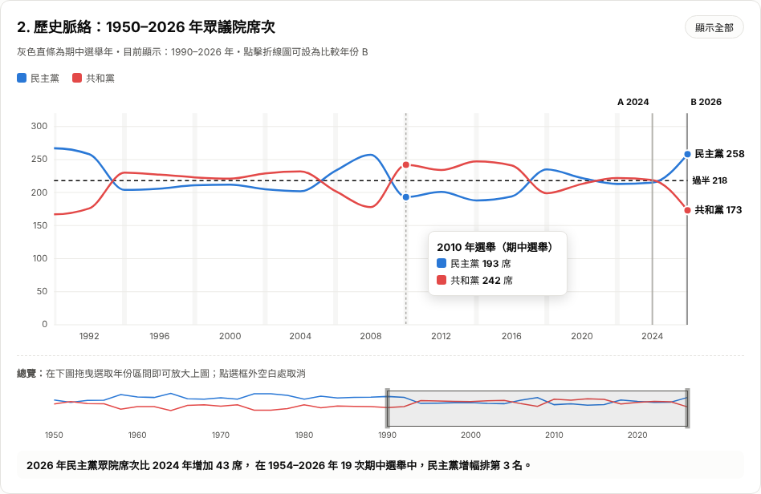
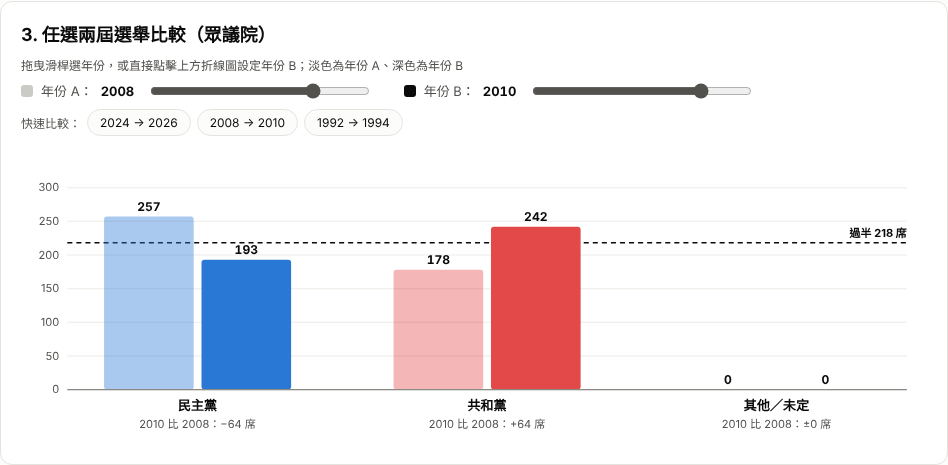
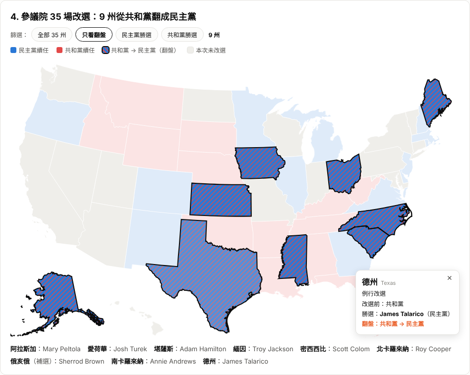

# 1151VIS-HW3：2026 美國期中選舉——民主黨重掌參眾兩院（Vue 3 + D3.js 動態視覺化）

- 學號／姓名：414085208／曾辰哲

## 1. 專案截圖

執行錄影（GIF）：眾議院開票播放 → 歷史折線圖 hover 與刷選放大 → 兩屆比較 → 切換參議院 → 地圖篩選與點選。


整體畫面：



| 1. 開票進度（眾議院 11/4） | 1. 開票進度（參議院 11/17） |
|---|---|
|  |  |

| 2. 歷史脈絡（刷選 1990–2026、hover 2010） | 3. 兩屆比較（2008 → 2010） |
|---|---|
|  |  |

4. 參議院改選地圖（篩選「只看翻盤」、點選德州）：



## 2. GitHub 連結

- Repository：https://github.com/Irving0522/1151VIS-HW3-414085208-TsengChenChe
- 線上展示（GitHub Pages）：https://irving0522.github.io/1151VIS-HW3-414085208-TsengChenChe/

## 3. YouTube 連結

- 視覺化互動影片：[【YouTube 連結】](https://youtu.be/mjXaLgoFU98)

## 4. 說明製作流程和相關操作

### 4-1. 新聞主題

2026 年 11 月 3 日美國期中選舉，民主黨同時拿回參議院與眾議院：

- **眾議院：** 民主黨 258 席，是 1992 年以來最多，截至 11/22 仍有 4 席未定。
- **參議院：** 民主黨陣營 56 席（民主黨 54＋獨立 2），共和黨 44 席，有 9 州從共和黨翻成民主黨。

新聞來源是中央社〈[美期中選舉創多項歷史紀錄　首見出櫃男同志與穆斯林參議員](https://www.cna.com.tw/news/aopl/202611040287.aspx)〉（2026/11/4），頁面上方附了該篇新聞的原圖。

### 4-2. 頁面內容與動態效果

| 區塊 | 內容 | 動態／互動 |
|---|---|---|
| 頂端院別切換 | 參議院／眾議院 | 一鍵切換，第 1～3 區同時更新；切換鈕固定在畫面頂端 |
| 1. 開票進度 | 三張數字卡、改選前 vs 目前長條、一格一席方格圖 | 時間軸按鈕與「▶ 播放開票過程」；長條用 D3 補間動畫，方格由左往右波浪換色；未定席次存在時，增減以區間表示 |
| 2. 歷史脈絡 | 1950–2026 年民主黨、共和黨席次折線圖，灰色直條標示期中選舉年 | **刷選放大**：在總覽小圖拖曳年份區間，主圖平滑放大；**hover**：顯示該年席次；**點擊**：設為比較年份 B |
| 3. 兩屆比較 | 任選兩個選舉年，比較民主黨、共和黨、其他的席次 | 兩個滑桿＋三個快速比較按鈕（2024→2026、2008→2010、1992→1994）；長條高度與數字用補間動畫變化 |
| 4. 參院改選地圖 | 35 州改選結果，9 個翻盤州加斜線與粗框 | **篩選**：全部／只看翻盤／民主黨勝選／共和黨勝選，不符合的州淡出；**hover** 顯示勝選人；**點擊**固定顯示州資訊卡 |

另外，第 2 區會由資料計算「2026 年民主黨眾院席次增加 43 席，在 1954–2026 年 19 次期中選舉中增幅排第 3 名」。前兩名是 1958 年的 +50 席與 1974 年的 +48 席。

### 4-3. 資料來源與整理

| 檔案 | 內容 | 來源 |
|---|---|---|
| `src/data/midterm2026.js` | 開票各時間點席次 | 中央社原圖（11/4）、[Congress Countdown](https://www.congresscountdown.com/elections/2026)（11/16）、[Yahoo News](https://www.yahoo.com/news/politics/article/lots-of-2026-midterm-races-still-havent-been-called-heres-where-things-stand-205425643.html)／[自由時報](https://news.ltn.com.tw/news/world/breakingnews/5650058)（11/22） |
| 同上 | 參院 35 場改選勝選人 | Congress Countdown |
| `src/data/history.js` | 1950–2024 年每屆國會開議時的席次 | [Wikipedia — Party divisions of United States Congresses](https://en.wikipedia.org/wiki/Party_divisions_of_United_States_Congresses) |
| `us-atlas` | 美國州界 TopoJSON | npm 套件 |

**推算與整理說明：**
- 11/22 眾院共和黨 173 席 = 435 − 258 − 4。
- 11/4 參院「民主黨 54 席」推算為民主黨 52＋獨立 2。
- Wikipedia 表中有「46/47」這類區間時，取國會開議當時的數字。
- 「其他」包含獨立議員、第三黨、空缺，以及 2026 年眾院的未定席次。

### 4-4. 使用技術與元件

| 技術 | 用途 |
|---|---|
| Vue 3（`<script setup>`） | 元件化；用響應式狀態管理院別、時間點、刷選範圍、比較年份、地圖篩選 |
| D3.js v7 | `d3.scaleLinear`／`scaleBand` 比例尺、`d3.line` + `curveMonotoneX` 折線、`d3.brushX` 刷選、`d3.bisector` 找最近年份、`d3.geoPath` 地圖、`d3.interpolate` + `d3.timer` 補間動畫 |
| topojson-client + us-atlas | 把州界 TopoJSON 轉成 GeoJSON |
| Vite + GitHub Actions | 開發、打包，並自動部署到 GitHub Pages |

| 檔案 | 負責內容 |
|---|---|
| `src/App.vue` | 頁面結構與狀態：院別、時間軸播放（`setInterval`）、刷選範圍 `zoom`、比較年份、地圖篩選；tooltip 用 `<Teleport>` 放到 body |
| `components/CompareBars.vue` | 改選前 vs 目前兩條等長堆疊長條（`useTween` 動畫） |
| `components/SeatWaffle.vue` | 一格一席方格圖（CSS transition＋依位置錯開延遲，形成波浪） |
| `components/HistoryChart.vue` | 1950–2026 年折線圖：x 範圍可動態縮放、`clipPath` 裁切、hover、點擊選年 |
| `components/HistoryBrush.vue` | 總覽小圖＋`d3.brushX`，選取範圍對齊到偶數年（選舉年） |
| `components/ElectionCompare.vue` | 兩屆比較分組長條（`useTween` 動畫），標示 B 比 A 增減幾席 |
| `components/SenateMap.vue` | 參院改選地圖：篩選時不符合的州淡出（CSS transition），點擊 emit 給 App 顯示資訊卡 |
| `composables/useTween.js` | 沿用 HW2 的 D3 補間動畫工具 |

### 4-5. 執行方式與相關操作

**線上版：** 直接打開 GitHub Pages 網址即可。

**本機執行：** 需要 Node.js（建議 20 以上的版本）。

```bash
npm install        # Windows PowerShell 若被擋，改用 npm.cmd install
npm run dev        # 或 npm.cmd run dev；打開 http://localhost:5173
```

| 操作 | 方法 |
|---|---|
| 切換院別 | 點頂端的「參議院／眾議院」 |
| 播放開票過程 | 第 1 區按「▶ 播放開票過程」，或點時間軸按鈕 |
| 放大某段歷史 | 第 2 區在總覽小圖上拖曳；按「顯示全部」或點空白處還原 |
| 查看某屆席次 | 滑鼠移到第 2 區折線圖上 |
| 比較兩屆 | 第 3 區拖曳滑桿、按快速比較，或點擊第 2 區折線圖設定年份 B |
| 篩選地圖 | 第 4 區點「只看翻盤」等按鈕 |
| 查看州資料 | 滑鼠移到州上看 tooltip；點擊州可以固定顯示資訊卡 |

### 4-6. GitHub 上傳與分享流程

1. 建立 repository `1151VIS-HW3-414085208-TsengChenChe`，Visibility 選 Public，`.gitignore` 選 HTML。
2. 上傳專案中除了 `node_modules`、`dist` 以外的所有檔案，包含 `.github/workflows/deploy.yml`。
3. 到 Settings → Pages，Source 設為「GitHub Actions」，等 Actions 跑完即可上線。
4. 到 Settings → Collaborators，新增 `cchu.fju@gmail.com`。
5. 錄製互動影片並上傳到個人 YouTube 頻道，把連結填入第 3 節。

### 4-7. 檔案結構

```
1151VIS-HW3-414085208-TsengChenChe/
├── index.html / package.json / package-lock.json / vite.config.js / .gitignore
├── .github/workflows/deploy.yml   GitHub Pages 自動部署
├── public/original-cna.jpg        新聞原圖
├── src/
│   ├── main.js / style.css / App.vue
│   ├── data/midterm2026.js        2026 開票資料、參院 35 場結果
│   ├── data/history.js            1950–2026 歷屆席次
│   ├── composables/useTween.js    D3 補間動畫
│   └── components/
│       ├── CompareBars.vue        改選前 vs 目前長條
│       ├── SeatWaffle.vue         一格一席方格圖
│       ├── HistoryChart.vue       歷史折線圖
│       ├── HistoryBrush.vue       總覽＋刷選
│       ├── ElectionCompare.vue    兩屆比較長條
│       └── SenateMap.vue          參院改選地圖
└── images/                        截圖、錄影 GIF
```
